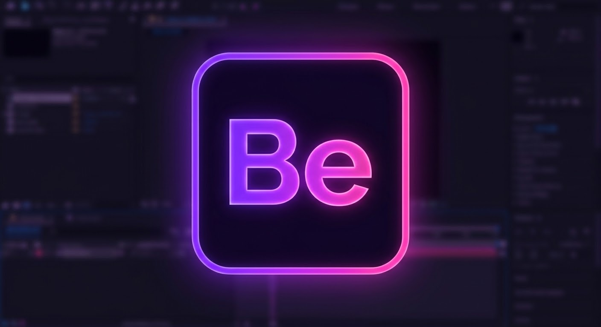
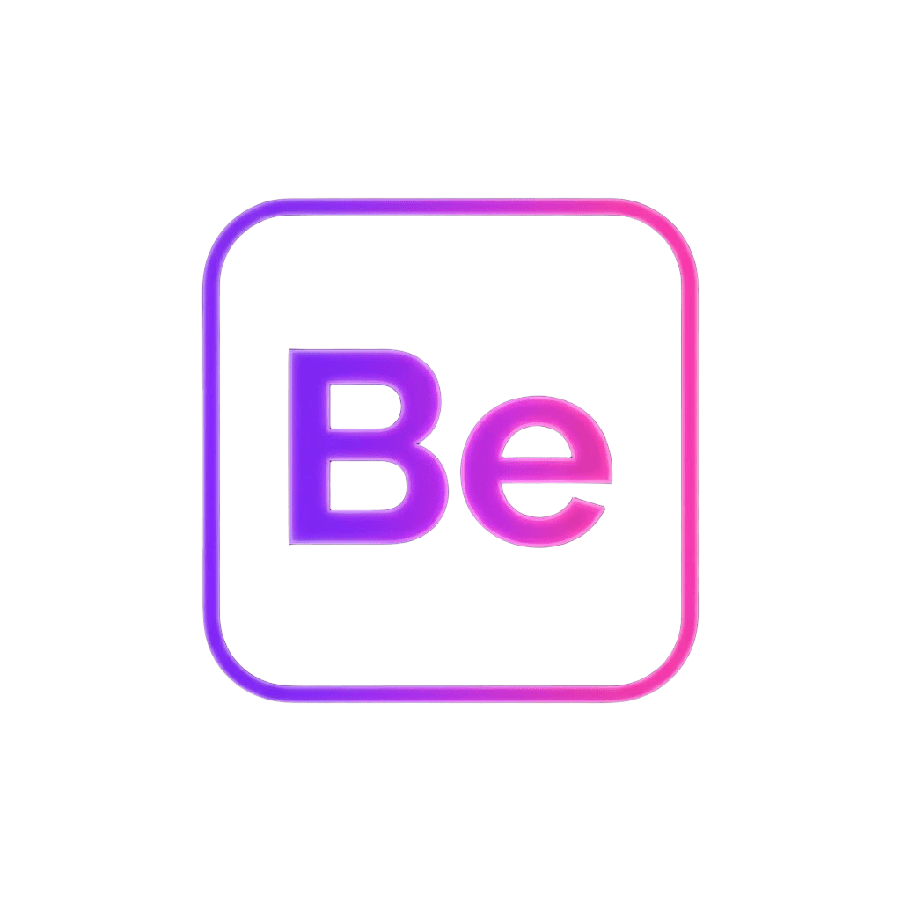

  

# 

  

 Before Effects

**Before Effects** — это экспериментальный open-source видеоредактор и инструмент для моушен-дизайна, написанный на Python и PyQt6. 

> *Проект полностью навайбкожен с нуля под впечатлением от Photocraft и Photopea. Это независимая попытка переосмыслить сложный профессиональный софт, сделать его интерфейс более стильным, а работу с анимацией — человеческой.*

## 🔥 Главная фишка: Умный Curve Editor
В отличие от перегруженного Graph Editor в коммерческих аналогах, в Before Effects реализован гибридный редактор кривых анимации:
* **Режим прямого добавления точек:** Просто кликаешь по линии интерполяции и гнешь её как хочешь, создавая новые ключи прямо «на лету».
* **Режим векторных усиков:** Классическое управление плавностью через интуитивные ручки Безье, работающие по кастомным математическим алгоритмам.

## 🛠 Технологический стек
* **UI/UX Движок:** PyQt6 (кастомные стыкуемые QDockWidget панели)
* **Ядро рендеринга:** OpenCV & NumPy (покадровая обработка матриц пикселей без использования закрытых проприетарных библиотек)
* **Стилизация:** Кастомный QSS-код в неоновом киберпанк-стиле.

## ⚠️ Legal Notice (Юридическая информация)
Before Effects является самостоятельным продуктом. Проект не использует декомпилированный код, бинарные файлы или зарегистрированные торговые марки сторонних компаний. Весь исходный код написан с нуля в образовательных целях и распространяется под лицензией MIT.
